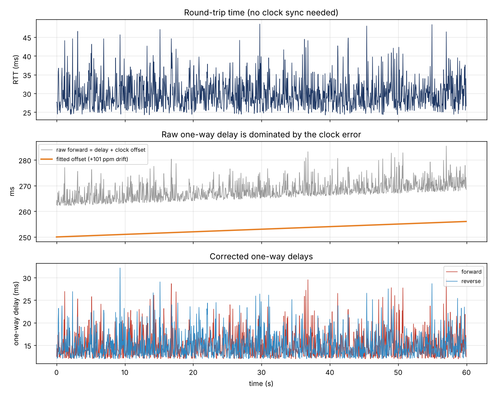

# twamp-latency-lab

A small, dependency-free Python toolkit for measuring network latency with **TWAMP-Light** ([RFC 5357](https://www.rfc-editor.org/rfc/rfc5357)): round-trip time, jitter, packet loss and **one-way delay**, including estimation of clock offset and drift between the two hosts.



*Simulated run: 12 ms each way plus queueing, with the reflector's clock 250 ms wrong and drifting 100 ppm. The tool recovers +249.985 ms and +100.6 ppm.*

## Why one-way delay is hard

Round-trip time is easy: both timestamps come from the same clock. One-way delay needs timestamps from **two different clocks**, so any clock difference shows up directly in the result. A clock that is 250 ms off makes a 12 ms path look like 262 ms, and a drifting clock makes it look like the network is slowly getting worse.

This tool:

1. Measures RTT exactly, with no clock sync needed: `RTT = (T4 − T1) − (T3 − T2)`.
2. Estimates the reflector's clock offset the way NTP does, `θ = ((T2 − T1) + (T3 − T4)) / 2`, using only the **lowest-RTT packets** (the ones that saw the least queueing).
3. Fits a **line through time** so a drifting clock is corrected too, not just a fixed offset.
4. Reports corrected forward and reverse delays, jitter (RFC 3550) and loss.

**Honest limit:** from round-trip data alone, path asymmetry and clock offset cannot be told apart. The correction assumes the fastest packets saw a roughly symmetric path. If the path is asymmetric (for example 20 ms out, 5 ms back), half the difference appears as clock offset. For true absolute one-way delay, sync both hosts with PTP or GPS and run the sender with `--assume-synced`. Delay *variation* in each direction is accurate either way.

## Quick start

```bash
pip install -e ".[plot]"          # or just run the modules with python -m

# On the far end (port 862 needs root; any port works)
twamp-reflector --port 8620

# On the near end
twamp-sender <reflector-ip> --port 8620 -c 600 -i 0.05 --csv run.csv --json run.json
twamp-plot run.csv -o run.png
```

Example output:

```
Packets: 1200 sent, 1186 received, 1.17% loss
                min      avg      p50      p95      max  (ms)
RTT          24.246   29.889   28.899   38.138   48.504
Forward      11.980   14.948   13.960   21.043   29.718
Reverse      11.991   14.941   14.058   20.880   32.148
Jitter (RFC 3550): RTT 5.935 ms, forward 3.861 ms, reverse 3.433 ms
Clock: reflector offset +249.985 ms at start, drift +100.6 ppm (230 low-RTT samples)
```

## Try it without two machines

**Simulation** (no network at all):

```bash
python -m twamplab.simulate --forward-ms 12 --reverse-ms 12 --offset-ms 250 --drift-ppm 100
python -m twamplab.plot simulated.csv
```

**Docker** (two containers with real packets; `tc netem` adds 20 ms forward and 5 ms reverse delay, 1% loss, and the reflector runs a deliberately wrong, drifting clock):

```bash
docker compose up --build --abort-on-container-exit
# results land in ./results/run.csv and ./results/run.json
```

Because the path is asymmetric, the estimated offset absorbs (20 − 5) / 2 = 7.5 ms on top of the injected clock error, which is exactly the limit described above. A real run:

```
Packets: 600 sent, 596 received, 0.67% loss
Clock: reflector offset +258.059 ms at start, drift +103.9 ppm (119 low-RTT samples)
```

That is the injected 250 ms plus the expected 7.5 ms of asymmetry, and the injected 100 ppm of drift.

**Demo flags on the reflector:** `--clock-offset SECONDS` and `--clock-drift-ppm PPM` make its clock wrong on purpose so you can watch the sender correct it. `--synced` sets the S flag in its Error Estimate field; leave it off unless the reflector's clock is synced by PTP or GPS.

## Sender options

| Option | Meaning |
|---|---|
| `-c, --count` | packets to send (default 100) |
| `-i, --interval` | seconds between packets (default 0.1) |
| `--padding` | bytes of padding (default 27, keeps sender and reflector packets the same size) |
| `--dscp` | DSCP marking for QoS tests |
| `--assume-synced` | clocks are synced externally (PTP/GPS); skip offset estimation and set the S (synchronized) flag in the Error Estimate field |
| `--csv`, `--json` | save per-packet results and the summary |

## Project layout

```
twamplab/
  packets.py    RFC 5357 test packet formats and NTP timestamps
  reflector.py  session reflector (with optional demo clock skew)
  sender.py     session sender, CLI and CSV/JSON output
  analysis.py   RTT, offset/drift fit, corrected one-way delay, RFC 3550 jitter
  simulate.py   synthetic runs with known ground truth
  plot.py       charts
tests/          packet, estimator and loopback tests (pytest)
```

## Scope

Implements unauthenticated **TWAMP-Light** test sessions (no TWAMP-Control negotiation), which is what most measurement setups and many routers use. Hardware timestamping is not used, so expect timing noise in the tens of microseconds from the operating system.

## Background

This project grew out of my 2022 internship work on TWAMP latency measurement, where clock synchronization between sender and receiver turned out to be the main barrier to trustworthy one-way delay. This is a fresh, independent implementation.

## License

MIT
